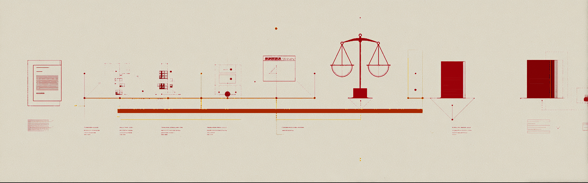

# Task Ledger



**Workplace communication in; a trustworthy, human-gated, provenance-backed
task board out.** Task Ledger listens to the places work is actually
discussed -- meeting transcripts, Teams channels, chats, email -- extracts
task-relevant signals with an LLM, reconciles them against a per-person
board, and proposes changes that a **human accepts or rejects**. Nothing
mutates the board without a decision record, and every confirmed fact can
be traced back to the exact utterance that produced it, by content hash.

The entire loop runs locally: Ollama for extraction and judging, Postgres
for the ledger, a Flask dashboard for drill-down, launchd for cadence.
Production wiring targets Microsoft Graph (Teams/Outlook subscriptions,
Adaptive Card review, AAD-scoped dashboard) and reuses the same code paths.

## Two invariants carry the design

1. **No board mutation without a human DecisionRecord.** Extraction and
   reconciliation only ever produce *proposals*. The apply path is a single
   database function, and it demands a decision.
2. **Evidence is pointers plus hashes, never copied content.** Signals cite
   source resources (utterance ids, message ids) with sha256 content
   hashes. The ledger can prove what was said without storing it.

Everything else follows: append-only event log with materialized
projections and a rebuild-honesty check; trust proportional to blast radius
(completions gated hardest); signals that fail a gate are *held* in the
pool, never guessed at; supersede semantics guarantee at most one open
review packet per person no matter how many runs stack up.

## Pipeline

```
Graph / inbox transcripts
   -> EXTRACT    one LLM call per window; typed signals with attribution
                 (explicit_assignment > self_reference > inferred),
                 deadline raw text + precision, hash-anchored evidence;
                 salvage + deterministic hallucination guards
   -> POOL       append-only signal pool per person
   -> RECONCILE  embeddings vs task alias sets; bands: auto-link / LLM
                 judge / new-task; per-type op gates; corroboration
                 requirements; noisy-OR aggregation; conflict flags
   -> REVIEW     ReviewPacket -> Adaptive Card (Teams) or review CLI
                 (local); accept / edit-accept / reject-with-reason /
                 defer; accepts re-validate against the current board
   -> LEDGER     apply_task_event() only; projections; provenance rail
   -> DASHBOARD  viewer-scoped (progress vs full_trace redaction);
                 "Trace to source" on every confirmed fact
```

## How we know the extraction works

`testdata/` contains a seeded generator of synthetic messy comms -- four
channel registers, guaranteed negation traps, third-party completion
claims, vague deadlines, name variants, distractor chatter -- and a scorer
that runs the real worker against golden labels. The harness is verified
honest (a cheating LLM scores 100%, an empty one 0%). Current state on
mistral-small3.1, prompt `extract-v1.1` plus deterministic guards, across
two seeds (one never seen during prompt development):

| metric | seed 7 | seed 11 (unseen) |
|---|---|---|
| recall | 97% | 94% |
| attribution (owner+basis) | 83% | 75% |
| vague-date safety | 100% | 100% |
| negation trap hits | 0 | 0 |
| fabrications | 0 | 0 |

The one prompt-resistant failure (deadline-removal language extracting as
a deadline signal, 3/3 at temperature 0) was moved into a code guard with
a recorded drop reason. Attribution's residual is absorbed downstream by
gates that fail closed. Reports are committed alongside the prompts;
re-run any seed to reproduce.

## Repository map

| dir | contents |
|---|---|
| `contracts/` | extraction + reconciliation JSON schemas, the shared language |
| `policy/` | matching thresholds, per-signal-type gates, judge prompts, calibration plan |
| `extraction/` | worker (salvage, guards), prompts (versioned), pg store, local runner |
| `reconciler/` | matcher + bands + gates, embedders (Ollama/offline), pg io w/ supersede, runner |
| `review_loop/` | packet orchestrator, Adaptive Card builder, simulator |
| `cli/` | terminal review: the local human loop |
| `storage/` | append-only schema, apply_task_event, projections, Q1-Q9 |
| `access/` | grants (user/project scope), progress vs full_trace, visible_tasks choke point |
| `integration/` | Graph ingestion, bot host, dashboard API + UI (+ USC/Keck theme) |
| `cadence/` | launchd weekday tick: inbox -> extract -> reconcile -> notify |
| `testdata/` | synthetic corpus generator + extraction scorer |
| `deploy/windows/` | no-admin Windows port (portable Postgres, Task Scheduler cadence) |

## Local quickstart (macOS)

```zsh
brew install postgresql@16 && brew services start postgresql@16
createdb taskintel
psql -d taskintel -f storage/schema.sql
psql -d taskintel -f access/access_control.sql
export DB_DSN="host=localhost port=5432 dbname=taskintel user=$(whoami)"
ollama pull mistral-small3.1 && ollama pull nomic-embed-text

cd extraction  && python3 test_extraction.py && cd ..
cd reconciler  && python3 test_reconciler.py && cd ..

# live loop: transcript -> proposals -> review -> provenance-backed fact
python3 extraction/run_local.py --transcript extraction/sample_transcript.json \
    --model mistral-small3.1 --write-db
python3 reconciler/run_reconcile.py --user aad-dev --dsn "$DB_DSN" \
    --embed-model nomic-embed-text --judge-model mistral-small3.1 --write
python3 cli/review.py --as aad-dev --dsn "$DB_DSN"
python3 integration/dashboard/dashboard_api.py   # http://127.0.0.1:8090
cd cadence && ./install_cadence.sh install       # weekdays 16:45, hands-free
```

## Production path (Microsoft Graph)

`integration/INTEGRATION.md` carries the checklist: Entra app
registration, protected-API approval for Teams message subscriptions,
HTTPS webhook for change notifications, Bot Framework registration with
JWT validation for review cards, AAD on the dashboard feeding the same
`visible_tasks` choke point. The ingestion and bot host code is built and
spoof-tested against those seams; what remains is registration, approval,
and endpoints.

## Status

Local system complete and validated end to end (storage, access,
extraction, reconciliation, review, dashboard, cadence -- 150+ checks
across module suites plus the live loop). Extraction quality measured on
synthetic messy corpora (table above). Not yet done: Graph/AAD production
wiring, live threshold calibration from real reject-reason data, periodic
task-merge scan, `signals.author_ref` migration.
